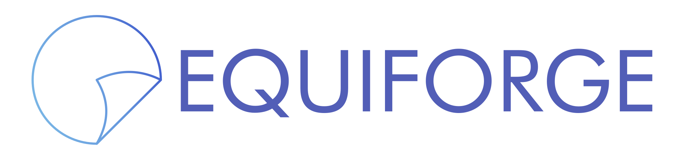

<p align="center">
    
</p>

<h4 align="center">
    A precision toolkit for equirectangular image processing and conversions
</h4>

<div align="center">
<a href="https://badge.fury.io/py/equiforge"></a>
<a href="https://pypi.org/project/equiforge"></a>
  <a href="https://github.com/MikkelKappelPersson/EquiForge/actions"></a>
  <a href="https://github.com/MikkelKappelPersson/EquiForge/blob/main/LICENSE"></a>
</div>

## Features

- Convert perspective images to equirectangular projection (`pers2equi`)
- Convert equirectangular images to perspective views (`equi2pers`)
- Runs on CPU and CUDA via torch
- HDR support with `output_dtype="float32"`

## Requirements

- Python 3.8+
- `numpy`, `torch>=2.4`, `Pillow`

## Installation

```bash
pip install equiforge
```

## Usage

```python
from equiforge import pers2equi, equi2pers

equi = pers2equi('input.jpg', output_height=1024, fov_x=90.0)

pers = equi2pers(
    'pano.exr',
    output_width=512, output_height=512,
    fov_x=90.0, yaw=45.0,
    use_gpu=True, output_dtype="float32",
)
```

```python
import torch
from equiforge import equi2pers

pano = torch.as_tensor(exr_array, dtype=torch.float32, device="cuda")  # (H,W,3)
for yaw in [0, 90, 180, 270]:
    view = equi2pers(pano, 512, 512, fov_x=90.0, yaw=yaw,
                     output_dtype="float32", device="cuda", as_tensor=True)
```

## API

- `output_dtype="uint8"` (default): clip to `[0,255]`.
- `output_dtype="float32"`: raw samples, no clip.
- `sampling_method="bilinear"` (default) or `"nearest"`.
- `device=None` auto-selects from `use_gpu`; pass `device="cpu"/"cuda"` to override.
- `as_tensor=True` returns a torch tensor instead of numpy.

## Acknowledgements:

- [equilib](https://github.com/haruishi43/equilib)
- [Perspective-and-Equirectangular](https://github.com/timy90022/Perspective-and-Equirectangular)
